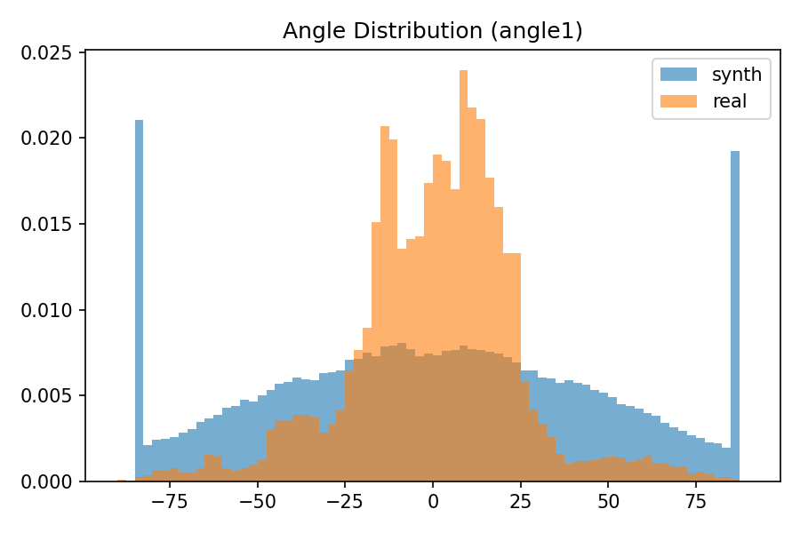
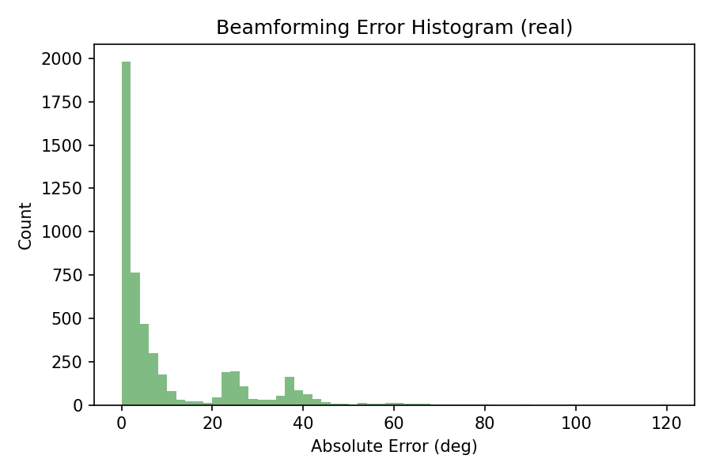
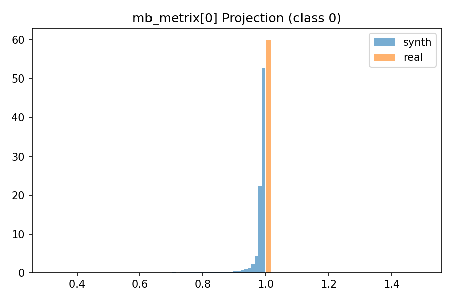
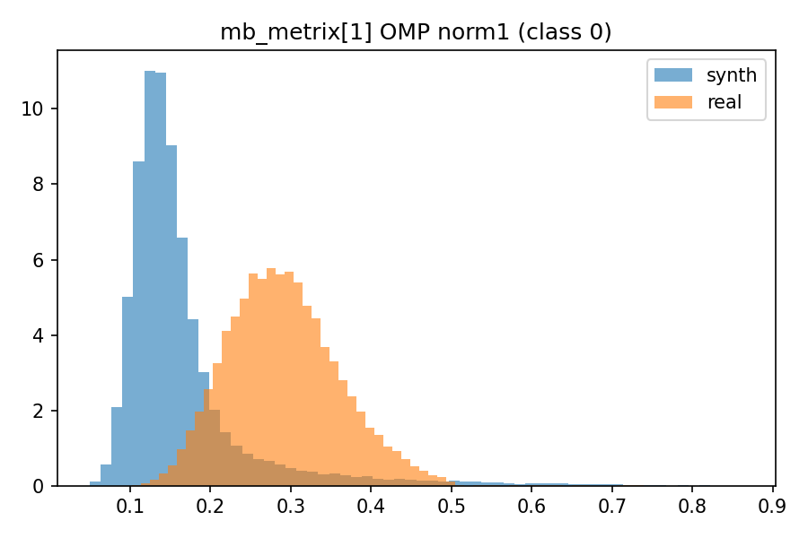
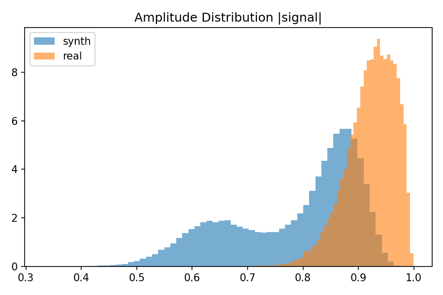
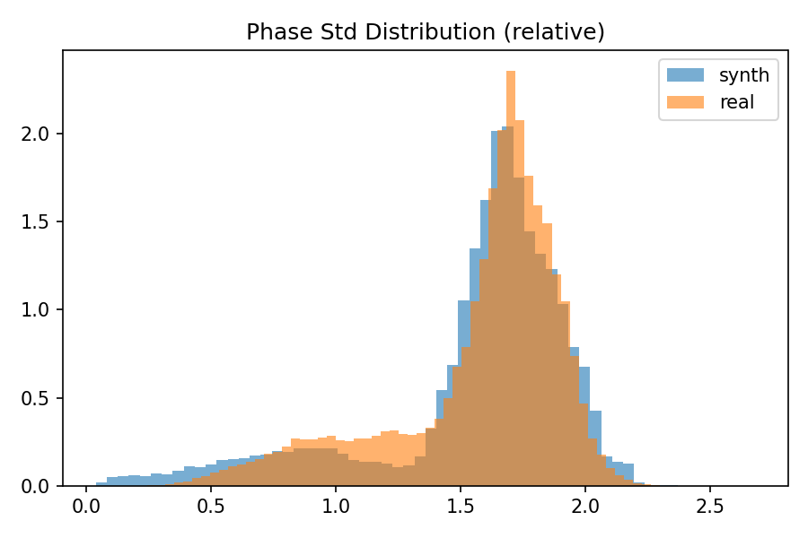
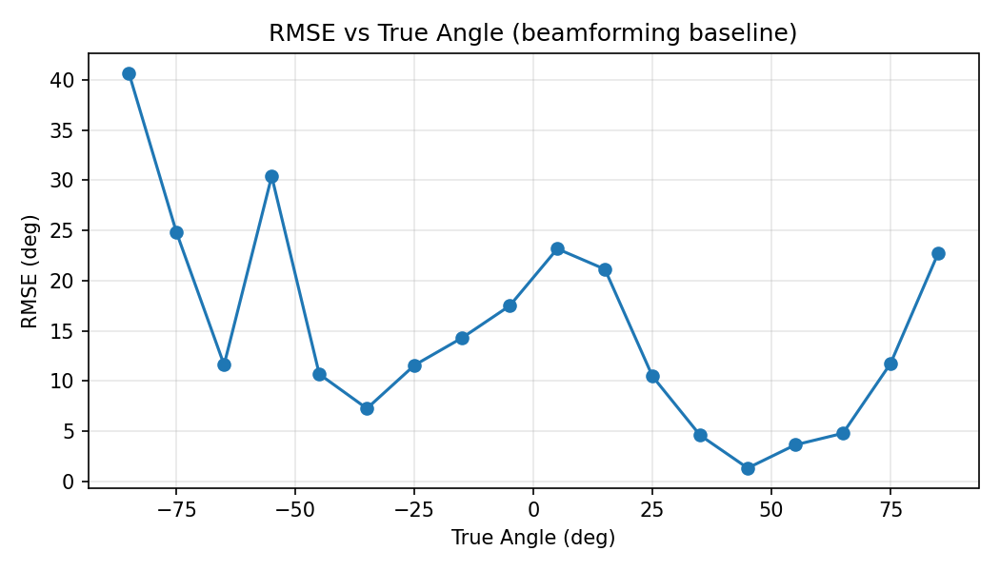
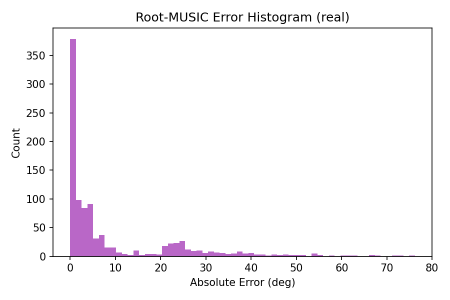

# Hypothesis Checks Report

## H1: Angle distribution mismatch
- JS divergence: 0.0497
- KS distance: 0.2232

## H2: Label correctness (beamforming baseline)
- RMSE: 17.54 deg
- MAE: 10.06 deg
- Median AE: 3.40 deg

## H3: Multipath inside class=0
- proj < 0.8: 0.0%
- omp1 > p95(synth): 22.8%

## H4: Noise / phase mismatch
- JS(amp): 15.1134
- JS(phase std): 3.1291

## H5: edge-effect

## H6: Root-MUSIC baseline
- RMSE: 16.26 deg
- MAE: 9.11 deg
- Median AE: 2.91 deg

## Files
- metrics.json: analysis\hypothesis_checks\metrics.json
- report.md: analysis\hypothesis_checks\report.md
