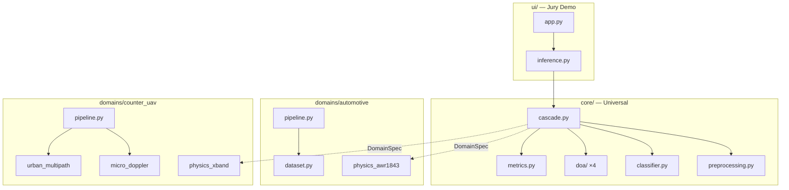

# ARCHITECTURE — целевая архитектура Array Cascade ITMO

**Версия:** 0.1 (спринт заявки, июнь 2026)  
**Источник правды:** `SPEC_ITMO_V2.md` §5–§6  
**Статус:** частично реализовано — см. §8 «Текущее состояние»

---

## 1. Обзор

Array Cascade ITMO — R&D проект: **универсальная cascade-архитектура** для многоканальной обработки сигналов в multipath-rich средах с **двумя прикладными доменами**:

| Слой | Назначение | Статус |
|---|---|---|
| **V1 — core/** | Домен-агностичный ML pipeline | Working integration layer |
| **V1 — domains/** | Физика, данные, train scripts per domain | Partially implemented |
| **V3 — counter_uav/** | Applied counter-UAV case | Physics + synth + improved ML baseline |
| **ui/** | Jury demo (FastAPI) | Live demo + fallback inference |

**Ключевой принцип:** «Можно ли переиспользовать в acoustic / WiFi без переписывания?» → если нет, код в `domains/*`, не в `core/`.

---

## 2. Cascade pipeline

```
┌─────────────┐    ┌─────────────┐    ┌─────────────┐    ┌─────────────┐    ┌─────────────┐
│ Raw signal  │───▶│ Whitening   │───▶│ Classify    │───▶│ Router      │───▶│ DOA (×4)    │
│ 8× complex  │    │ Wiener-Hopf │    │ ComplexNet  │    │ skip clutter│    │ Siamese…    │
│ 1 snapshot  │    │ + RMS norm  │    │ N classes   │    │ route DOA   │    │ parallel    │
└─────────────┘    └─────────────┘    └─────────────┘    └─────────────┘    └─────────────┘
                                                                                    │
                                                                                    ▼
                                                                           ┌─────────────┐
                                                                           │ CascadeResult│
                                                                           │ class, angles│
                                                                           │ confidence   │
                                                                           └─────────────┘
```

**Router logic:**
- `clutter` / pure multipath-only scenes → DOA skipped (`doa_angles = None`)
- Single-target classes → 1 angle
- `two_targets` / `multi` → 2 angles

---

## 3. Структура репозитория (target)

```
Array_Cascade_ITMO/
├── SPEC_ITMO_V2.md              # Спецификация (source of truth)
├── PROJECT_README.md            # Entry point
│
├── core/                        # ← домен-агностичный слой
│   ├── preprocessing.py         # Wiener-Hopf + RMS
│   ├── cascade.py               # Cascade + DomainSpec + CascadeResult
│   ├── classifier.py            # ComplexNet (abstract N classes)
│   ├── metrics.py               # RMSE, MedAE, SR@k°
│   ├── physics.py               # Steering matrix abstraction (DI)
│   └── doa/
│       ├── siamese.py
│       ├── lista.py
│       ├── covrecon.py
│       └── hiergru.py
│
├── domains/
│   ├── automotive/              # TI AWR1843, 77 GHz
│   │   ├── config.py
│   │   ├── dataset.py
│   │   ├── physics_awr1843.py
│   │   ├── classes.py           # direct / multipath / two_targets
│   │   └── pipeline.py
│   │
│   └── counter_uav/             # X-band 12.5 GHz
│       ├── config.py
│       ├── dataset_synth.py
│       ├── physics_xband.py
│       ├── micro_doppler.py
│       ├── urban_multipath.py
│       ├── classes.py           # clutter / drone / bird / multi
│       └── pipeline.py
│
├── scripts/
│   ├── train_automotive.py
│   ├── train_counter_uav.py
│   ├── evaluate_automotive.py
│   ├── evaluate_counter_uav.py
│   └── audit_baseline.py
│
├── ui/                          # Jury demo
│   ├── app.py                   # FastAPI routes
│   ├── services/
│   │   ├── inference.py         # load_models(), run_cascade()
│   │   ├── presets.py           # 6 built-in signals
│   │   └── plots.py             # Plotly builders
│   └── templates/               # 6 Jinja2 pages
│
├── analysis/                    # Evaluation scripts
├── notebooks/                   # EDA, demo_universal_cascade.ipynb
├── docs/
│   ├── ITMO_application/
│   ├── BASELINE_CONFIRMED.md
│   └── ARCHITECTURE.md          # этот файл
│
├── output_automotive/           # weights + metrics (ex-output/)
└── output_counter_uav/          # counter-UAV artifacts
```

**Legacy compatibility:** корневые `config.py`, `dataset.py`, `models.py`, `run_full_pipeline.py` остаются рабочими до завершения миграции в `domains/automotive/`.

---

## 4. Core API

### 4.1. DomainSpec

Описание физического домена — единственное, что меняется между automotive и counter-UAV:

```python
@dataclass
class DomainSpec:
    name: str
    n_ant: int                       # 8
    array_pos: np.ndarray            # позиции в λ/2
    wavelength: float                # метры
    n_grid: int                      # 361 → 0.5° step
    classes: list[str]               # domain-specific
    doa_classes: list[str]           # subset для DOA
```

**Factory methods:**
- `DomainSpec.automotive()` — 77 GHz, 3 classes
- `DomainSpec.counter_uav()` — 12.5 GHz, 4 classes

### 4.2. Cascade

```python
class Cascade:
    def __init__(
        self,
        domain: DomainSpec,
        classifier: ComplexNet,
        doa_models: dict[str, nn.Module],
        preprocessor: Preprocessor,
    ): ...

    def forward(
        self,
        signal: torch.Tensor,
        doa_method: str = "siamese",
    ) -> CascadeResult: ...
```

### 4.3. CascadeResult

```python
@dataclass
class CascadeResult:
    scene_class: int
    scene_logits: np.ndarray
    doa_angles: np.ndarray | None
    doa_confidence: np.ndarray | None
    latency_ms: float
```

**Acceptance (AC-5):** один `Cascade` class, два `DomainSpec`, zero diff в `core/cascade.py`.

---

## 5. Domain specifications

### 5.1. Automotive (legacy, working)

| Параметр | Значение |
|---|---|
| Sensor | TI AWR1843 |
| Frequency | 77 GHz (λ ≈ 3.9 mm) |
| Array | 8 virtual, ULA, aperture 1.75λ |
| Classes | direct, multipath, two_targets |
| Data | `train_validate/*.txt` (real) + `synth_new.npz` |
| Best DOA | Siamese MedAE **0.66°** synth-val |

### 5.2. Counter-UAV (sprint target)

| Параметр | Значение |
|---|---|
| Radar | X-band 12.5 GHz (λ = 24 mm) |
| Array | 8-el ULA, λ/2 spacing |
| Range | 50–1000 m |
| Classes | clutter, drone, bird, multi |
| Micro-Doppler | 4-motor quad vs bird wing-beat 3–8 Hz |
| Multipath | Method of images, N_walls ∈ {0,2,4,6} |
| Data | `output_counter_uav/synth_10k.npz` (generated) |

---

## 6. ML stack

| Component | Technology | Notes |
|---|---|---|
| Framework | PyTorch 2.x | complex64 native |
| Precision | AMP (mixed) | Except CovRecon (float32 eigen) |
| GPU | RTX 2060 SUPER 8 GB | Batch sizing per SPEC §8 |
| Classifier | ComplexNet ~150K params | N classes per domain |
| DOA methods | 4× SOTA ~50–700K each | Parallel inference |
| Latency target | < 10 ms end-to-end | batch=1, GPU proxy |

### Важная оговорка по counter-UAV метрикам

Текущие counter-UAV метрики из `output_counter_uav/metrics.json` являются **улучшенным engineering baseline**, а не финальной научной оценкой. После фикса synthetic generator, raw/grid contract и classifier canonicalization качество выросло до classifier `59.9%` и `Siamese` RMSE `4.49°`, но AC-3/AC-4 всё ещё не достигнуты. Это важно: проблема была частично в данных и train/runtime contract, а не только в модели.

Следующий шаг: продолжать улучшение drone/bird discrimination и multi-target semantics без возврата к несогласованному preprocessing path.

### DOA methods comparison

| Method | Type | Synth MedAE | Strength |
|---|---|---|---|
| Siamese | Embedding + regression | 0.66° | Best overall |
| LISTA | Physics-informed unfolding | 0.73° | Best SR@3° |
| CovRecon | Covariance + Root-MUSIC | 2.03° | Interpretable |
| HierGRU | Coarse-fine BiGRU | 1.58° | Needs >120 ep |

---

## 7. UI architecture (jury demo)

```
Browser ──HTTP──▶ FastAPI (ui/app.py)
                      │
                      ├── Jinja2 templates (6 pages)
                      ├── StaticFiles (/static)
                      └── lifespan → load_models()
                              │
                              ▼
                      ui/services/inference.py
                              │
                              ▼
                      core.cascade.Cascade
                              │
                    ┌─────────┴─────────┐
                    ▼                   ▼
            DomainSpec.automotive   DomainSpec.counter_uav
```

### Routes

| Route | Template | Purpose |
|---|---|---|
| `/` | index.html | Landing, KPI, cascade diagram |
| `/demo` | demo.html | Live cascade on presets |
| `/methodology` | methodology.html | V1 two-domain proof |
| `/counter_uav` | counter_uav.html | V3 micro-Doppler, multipath |
| `/roadmap` | roadmap.html | 4-semester Gantt |
| `/about` | about.html | Application text |
| `/health` | JSON | Smoke test |

### Inference contract

```python
def load_models() -> dict: ...
def run_cascade(signal, domain, snr=None) -> CascadeRunResult: ...
```

6 presets: 3 automotive (a1–a3) + 3 counter-UAV (u1–u3) — см. `ui/services/presets.py`.

---

## 8. Текущее состояние реализации (июнь 2026)

| Component | Status | Notes |
|---|---|---|
| `core/doa/*` | 🟡 Re-export | Real code still lives in `models.py`; migration incomplete |
| `core/cascade.py` | ✅ Working | `Cascade.forward()` implemented for automotive/counter-UAV |
| `core/preprocessing.py` | ✅ Present | Wrapper over legacy preprocessing |
| `core/classifier.py` | ✅ Present | Re-export of configurable `ComplexNet` |
| `core/metrics.py` | ✅ Present | Re-export of legacy metrics |
| `domains/automotive/*` | 🟡 Minimal | `config.py`; root legacy scripts remain main training runtime |
| `run_full_pipeline.py` | ✅ Legacy root | Working automotive pipeline, locally reproduced |
| `domains/counter_uav/*` | ✅ First implementation | Physics, micro-Doppler, multipath, synth, training pipeline |
| `ui/app.py` | ✅ 6 routes + API | `/api/run_cascade`, `/api/run_both` |
| `ui/services/inference.py` | ✅ Live/fallback | Loads models when artifacts exist |
| `ui/templates/*` | ✅ 6 pages | Demo page has Plotly fetch flow |
| Local baseline repro | ✅ Done | See `docs/BASELINE_CONFIRMED.md` |

**Honest summary:** architecture proof-of-concept works, but the target clean split from SPEC §5 is **not fully completed**. `core/` is currently an integration layer over legacy code, not a fully migrated framework.

---

## 9. Data flow

### Training (automotive)

```
prepare_data.py
    → synth_new.npz (balanced, uniform angles)
    → real .txt from train_validate/

run_full_pipeline.py
    → pretrain classifier (synth)
    → finetune classifier (real)
    → train 4 DOA (synth)
    → evaluate (real) → domain gap documented
```

### Training (counter-UAV, first implementation)

```
domains/counter_uav/dataset_synth.py
    → synth_10k.npz (drone/bird/clutter/multi)

domains/counter_uav/pipeline.py
    → train classifier (4 cls)
    → train Siamese + LISTA DOA (CovRecon/HierGRU pending)
    → metrics.json + confusion matrix JSON
```

### Inference (UI demo)

```
preset selection (/demo)
    → presets.py → signal tensor
    → inference.run_cascade(signal, domain)
    → CascadeResult → plots.py → Plotly HTML
```

---

## 10. Roadmap extensions (post-sprint)

| Phase | Addition | Layer |
|---|---|---|
| Sem 1 | DIAT-µSAT adapter | `domains/counter_uav/` |
| Sem 2 | IMM + JPDA tracker | `core/tracker/` (new) |
| Sem 3 | Acoustic DomainSpec + fusion | `domains/acoustic/`, `core/fusion/` |
| Sem 4 | Edge inference on Pi 5 | `scripts/edge_deploy.py` |

---

## 11. Design decisions

| Decision | Rationale |
|---|---|
| Single snapshot M=1 | Hardest regime; matches AWR1843 data format |
| 4 parallel DOA methods | Comparison + future ensemble; not single black box |
| DomainSpec injection | V1 proof: same Cascade, different physics |
| No jamming / kinetic | Ethical + legal safety |
| Synth-first counter-UAV | No radar purchase in sprint; public datasets in MA |
| FastAPI + Jinja2 UI | Zero node.js build; jury-readable source |
| Honest domain gap docs | Scientific maturity over marketing |

---

## 12. Diagram: two domains, one core



---

## 13. References

- `SPEC_ITMO_V2.md` — full specification
- `PROJECT_README.md` — quick start
- `docs/BASELINE_CONFIRMED.md` — metrics template
- `docs/ITMO_application/gap_analysis.md` — synth→real
- `ui/README.md` — UI run instructions
