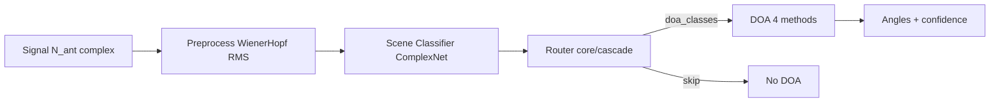

# Cascade architecture diagram

## Two-domain proof

| Component | Automotive | Counter-UAV |
|---|---|---|
| Wavelength | 77 GHz | 12.5 GHz X-band |
| Classes | 3 | 4 |
| Cascade core | shared | shared |
| Physics | domains/automotive | domains/counter_uav |
